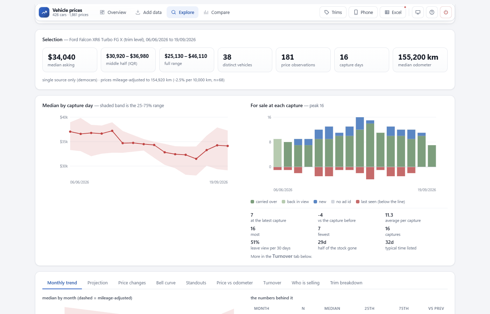
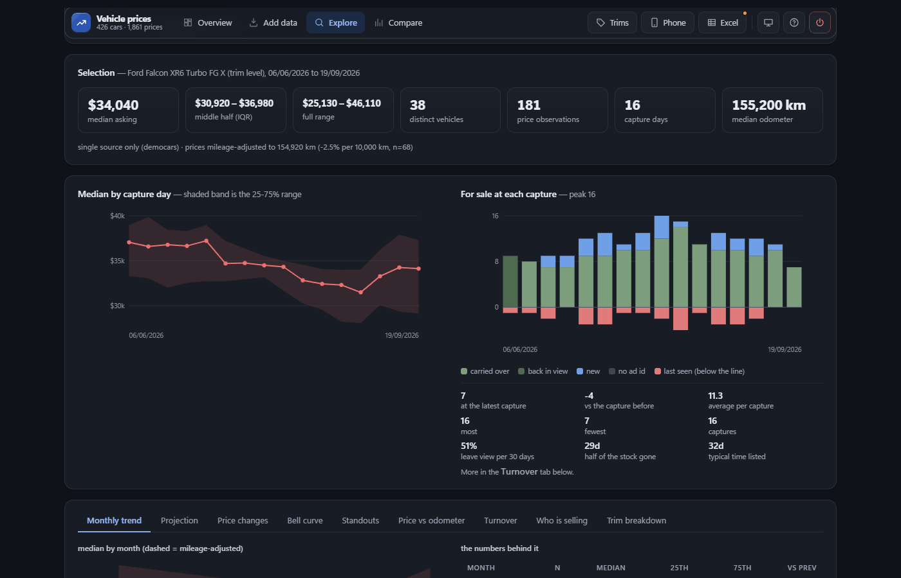
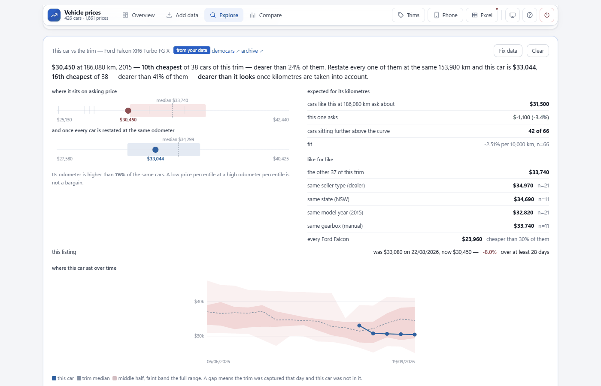
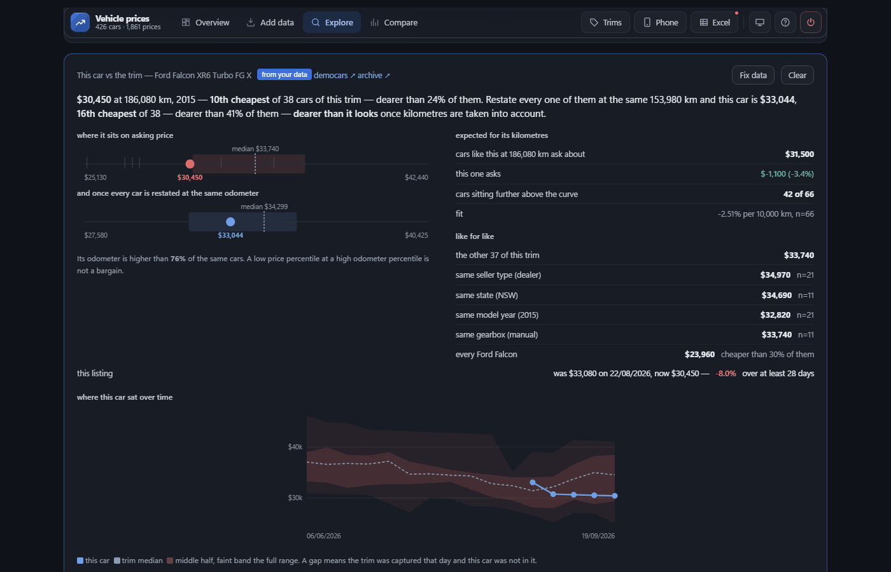
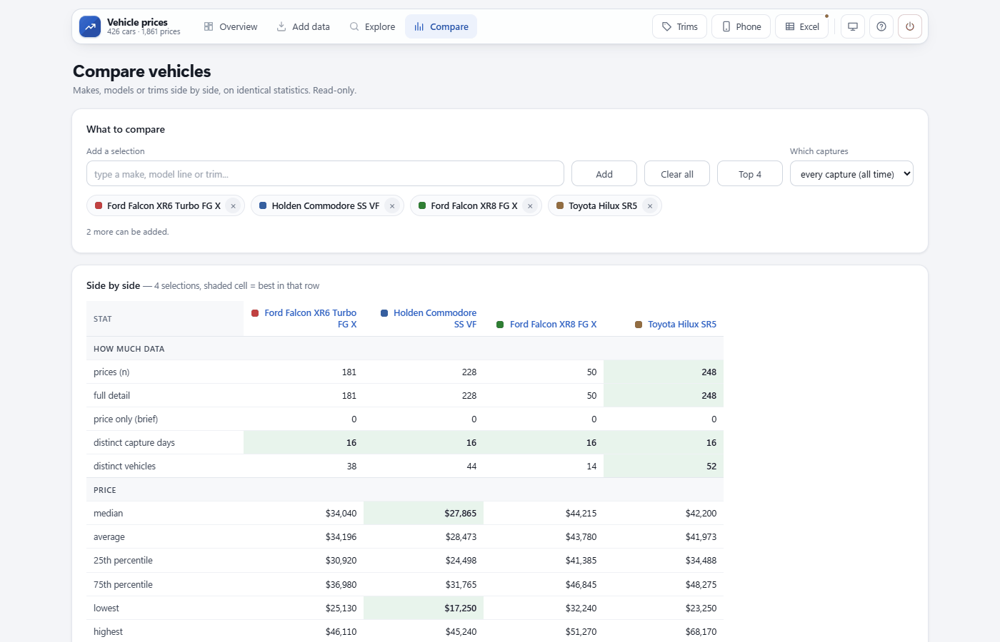
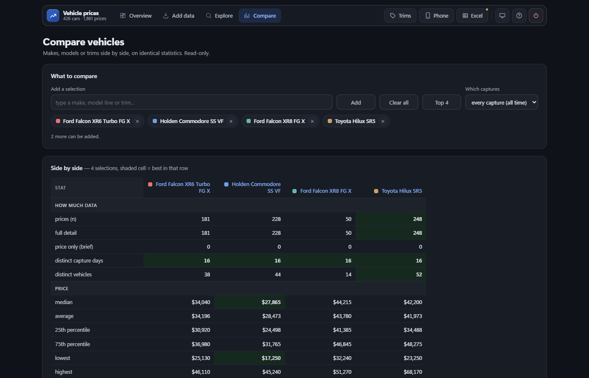
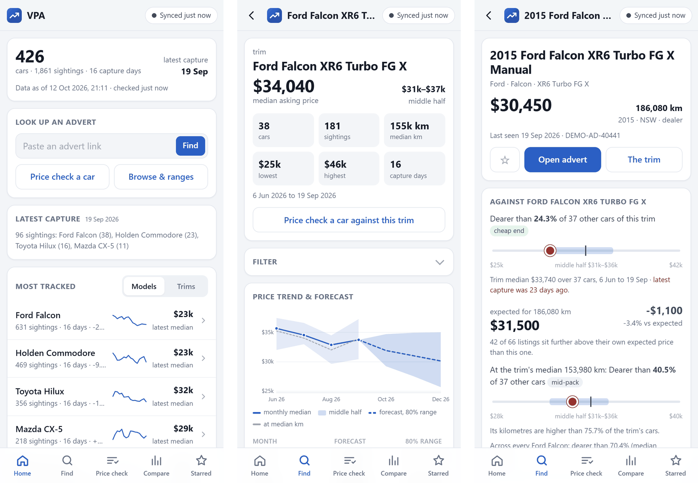
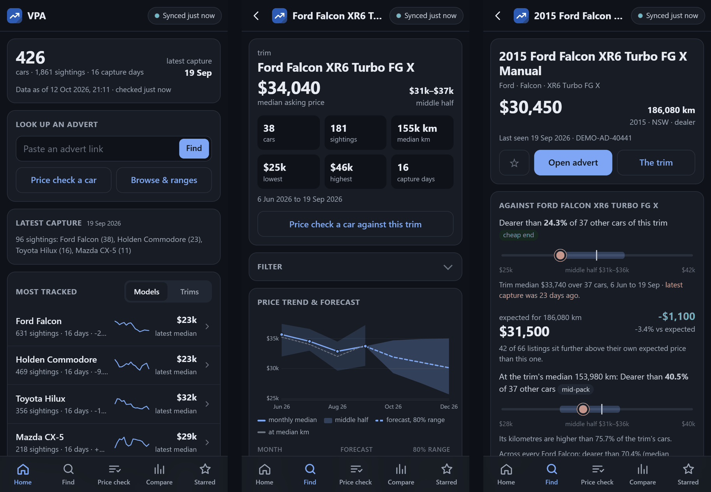

# Vehicle Price Analysis

A local app for tracking used car and motorbike prices in Australia. You save
listing pages as you browse, drop them into the app, and over a few weeks it
builds up a price history: what a trim is worth, which cars are cheap for
their kilometres, how fast each trim sells, and where prices are heading.

It runs on your own computer with a SQLite database. There is also a phone
app that syncs a read-only copy over your home Wi-Fi.



*All screenshots use made-up demo data (`tools/demo_data.py`).*

## Screenshots

| Light | Dark |
|---|---|
|  |  |
|  |  |
|  |  |

The phone app (home, a trim, one car):




## How it gets its data

You collect the listings yourself. The app has no scraper, makes no network
requests to listing sites and doesn't log in anywhere. It only reads files
you give it:

- web pages you saved with Ctrl+S
- text you copied from a results page
- CSV or JSON exports

Most listing sites don't offer a price API and don't allow automated
collection, so this is the only way it works. If a site shows you a
"checking your browser" page and you save that by mistake, the app tells
you the file isn't a listings page and skips it.

## Features

- **Explore**: median, quartiles and spread for any make, model or trim,
  with a chart per capture day, supply over time, a monthly trend and a
  forecast.
- **Car check**: pick one car (or type in one you've seen) and see where it
  sits against its trim, what cars like it ask for its kilometres, and
  like-for-like comparisons by seller, state, year and gearbox.
- **Price check**: enter kilometres and year and get the range similar cars
  are asking.
- **Mileage adjustment**: a robust fit of price against odometer, so cars
  with different kilometres can be compared fairly.
- **Turnover**: how many cars arrived and left between captures, how fast a
  trim clears, and how long cars stay listed. It never claims a car sold;
  it only knows the listing disappeared.
- **Compare**: up to six selections side by side on the same statistics.
- **Watchlist**: star cars and see how their prices move against their trim.
- **Trim grouping**: "Auto quattro MY18" and "quattro", or "Mk II" and
  "MkII", count as the same trim. Stored names are never changed. BMW,
  Ford, Audi, Lexus and Corvette generations are recognised from codes and
  model years.
- **Duplicates**: finds the same car captured twice under different ids and
  merges it only when you confirm. Every merge can be undone.
- **Phone app**: a read-only copy of your data that works offline, with the
  same numbers as the laptop. You can star cars from the phone.
- **Light and dark themes** on both the laptop and the phone.
- **Australian dates**: 19/09/2026, or 19 Sep 2026 on the phone. The database
  and exports keep ISO dates (2026-09-19) so they sort correctly.
- **Excel workbook** with pivots and charts, if you prefer spreadsheets.

When there isn't enough data for a statistic, the app says so instead of
showing a number.

## Install

Python 3.11 or newer.

```bash
python -m pip install -r requirements.txt
```

Only `pandas`, `numpy` and `openpyxl` are required. The rest add
forecasting and charts, and the app works without them.

## Try it with demo data

```bash
python tools/demo_data.py
```

This builds a database of about 400 made-up cars and opens the app on it at
`http://127.0.0.1:8873`. Nothing is written to your own `data/` folder.

## Run

```bash
python -m vpa import-ui
```

The app opens at `http://127.0.0.1:8765`. On Windows, `Setup VPA.bat` adds
a VPA shortcut to the Desktop and Start menu.

| Page | What it's for |
|---|---|
| Overview | what you've collected, and a check that the numbers add up |
| Add data | import with preview, bulk upload, or quick add of a single price |
| Explore | one trim in detail, and one car against its trim |
| Compare | several trims or models side by side |
| Duplicates | the same car captured twice |
| Trims | how trim names are grouped, and the rules behind it |
| Phone | turn on phone sync and pair a phone |

## Collecting listings

1. Search on a listing site in your browser as usual.
2. Save the results page (Ctrl+S), or select the results and copy them.
3. Drop the files onto **Add data**. Each file keeps the date you saved it.
4. Check the preview and commit.

Once a search parses cleanly, you can switch to **Bulk upload** and drop a
week's worth of files at once. It takes a backup first and each run can be
undone. There is also a watch folder: anything you save into it is imported
automatically.

Do this every week or so and you get a price history. The same listing seen
on three dates is stored as one car with three prices.

## Your sites file

The code doesn't name any website. The sites you collect from are listed in
a private file, `data/sites.json`, which is never committed. It holds each
site's label, the words that identify its pages and links, its address (for
"open advert" links), its ad id format and its photo server. Copy
`sites.example.json` to `data/sites.json` and fill it in.

Without the file the app still works. Imports are labelled `other`, and
there are no advert links or photos.

The label is part of each stored car's identity, so don't rename a label
once you have data under it.

## Keeping the data safe

- Imports show a preview and write nothing until you commit.
- Bulk uploads take a backup first and can be undone completely.
- Manual corrections run in a single transaction, check the totals before
  saving, and record the old value so they can be undone.
- `python -m vpa verify` recomputes the totals two independent ways and
  compares them.

`data/` and `output/` are in `.gitignore`. Saved pages are copies of other
people's listings, so don't share them or your database.

## Command line

```bash
python -m vpa status                       # what's in the database
python -m vpa ingest saved_page.html       # import a saved page
python -m vpa ingest listings.csv --source mysite
python -m vpa add --make Ford --model Falcon --year 2012 --price "$18,990" --odo 145000
python -m vpa report --segment "ford falcon"
python -m vpa export                       # everything to CSV
python -m vpa viewer                       # build the Excel workbook
python -m vpa verify                       # check the data against itself
python -m vpa merge-duplicates             # dry run; --apply for proven ones only
python -m vpa edit --history               # manual corrections, and undo
python -m vpa trims                        # how trim names are grouped
python -m vpa photos --backfill            # read photo addresses from kept pages
```

## Tests

```bash
python -m tests.run_all            # all 26 suites, six at a time (~1.5 min)
python -m tests.run_all --quick    # skip the Excel suite (~45 s)
python -m tests.run_all --real     # also check the phone app on a read-only
                                   # copy of your own data (~3.5 min)
```

About 820 checks covering parsing, the statistics, every page over HTTP,
duplicates and undo, phone sync, and the phone app's numbers against the
laptop's (needs Node.js). The Excel suite opens the workbook in real Excel
and needs Excel installed. Logs go to `tests/synthetic/logs/`.

## Making changes

The database can't be rebuilt, so changes follow the same routine:

1. Commit first.
2. `python tools/dbguard.py --save` records a fingerprint of every row.
3. Make the change, with a test that fails without it.
4. `python -m tests.run_all --real`
5. `python tools/equiv.py` runs the last commit and your working copy on a
   copy of your data and lists every difference: imported records, links,
   photos, duplicates, Explore, car checks and Compare.
6. `python tools/scratch_app.py` opens the app on a throwaway copy to try
   things by hand.
7. `python tools/dbguard.py --check` confirms the data hasn't changed.

To share the code, `python tools/make_package.py` builds a zip of the
committed files only (no data, no history) and refuses if any name from
your sites file appears in it.

## Layout

```
vpa/            the app
  adapters/     readers for saved pages, pasted text, CSV and JSON
  analyze.py    statistics
  explore.py    Explore page and the car check
  trims.py      trim grouping and generations
  turnover.py   arrivals, exits and time listed
  phone_app/    the phone app
tests/          test suites
tools/          demo data, packaging and the safety tools
docs/           screenshots
data/           your database and sites file (not committed)
output/         reports and the workbook (not committed)
```

`NOTES.md` is the development log: design decisions, things that were tried
and dropped, and bugs worth remembering.

## Licence

MIT, see `LICENSE`.
